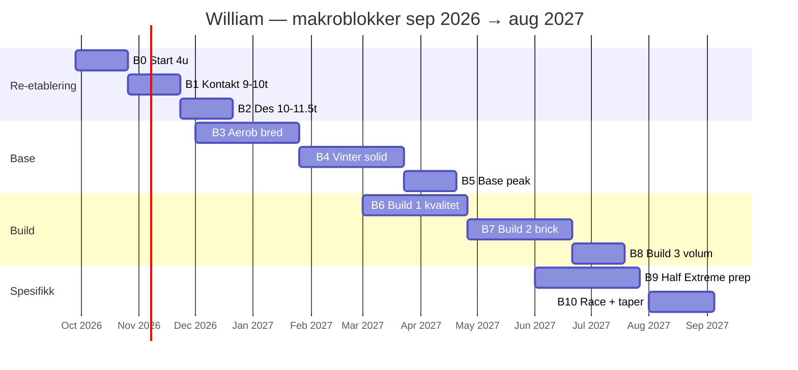

# Blokk- og periodiseringsplan — Half Extreme 2027

**For:** William · **Race:** Lofoten Half Extreme (aug 2027, ca.)  
**Årsmål:** 750–800 t (rullerende 12 mnd) · **Snitt når du er oppe:** ~14,5–15,5 t/uke  

Dette dokumentet svarer på: *Hvorfor disse periodene, og hva skal hver fase få til?*  
Detaljerte månedstall: [`2026-2027-12mnd-periodisering.md`](2026-2027-12mnd-periodisering.md). Faglig bakgrunn: [`knowledge/triathlon/periodisering-mot-2027.md`](../knowledge/triathlon/periodisering-mot-2027.md).

---

## Overordnet logikk (én setning per lag)

| Lag | Tanke |
|-----|--------|
| **År** | Bygge **aerob + MSK** på tre ben mot 750–800 t — ikke 2019-volum på 2026-kropp |
| **Fase** | Først **kontakt og vane**, så **bred base**, så **kvalitet + brick**, til slutt **Lofoten-spesifikk + taper** |
| **Blokk (4 uker)** | 3 uker progresjon → **1 recovery** (OPV «ressursuke») — **mengde-tabell:** [`mengdeperioder-2026-2027.md`](mengdeperioder-2026-2027.md) |
| **Uke** | Ett tydelig fokus + TP-kommentarer ([`trener-feedback-syklus.md`](../docs/trainingpeaks/trener-feedback-syklus.md)) |

**Prioriteringsfilter** (fra profil): kontinuitet → skadefrihet → gradvis progresjon → aerob → Lofoten → prestasjon.

---

## Tidslinje (makro)

*(Datoer er veiledende — skyves med liv, sykdom og TP-faktisk volum.)*

---

## De ti makroblokkene — hva vi prøver å få til

### B0 — Startblokk (28. sep – 25. okt 2026) · **Re-etablering**

| | |
|---|---|
| **Timer** | ~5,5 → ~8 t/uke (uke 4 recovery ~4,5 t) |
| **Hvorfor nå** | Du kommer fra lav og ujevn belastning; hjerte/lunger kan mer enn sener. Vi **kjøper kontakt**, ikke fitness. |
| **Suksess** | 3 svøm/uke i snitt, ingen skadeopptrapping, du **kommenterer** økter i TP |
| **Ikke nå** | Crisscross, 18×3′, elghufs hard, FTP-maks |
| **Planfiler** | [`2026-09-28-uke-01.md`](2026-09-28-uke-01.md) … [`uke-04.md`](2026-09-28-uke-04.md) |

---

### B1 — Kontakt II (26. okt – 22. nov 2026) · **Re-etablering**

| | |
|---|---|
| **Timer** | **~9 → 10 t/uke** (uke 8 recovery **~7,5 t**); **ikke** årets topp — se [`2026-post-deload-ramp.md`](2026-post-deload-ramp.md) |
| **Hvorfor** | Struktur etter deload; kvalitet (myr, elghufs, FTP) uten å topp-load november |
| **Fokus** | Svøm 3×, løp **myr/elghufs lett** (OPV), sykkel Z2 + **rest-teknikk** (ettbens), styrke 2× |
| **Tester** | **FTP ramp** (sykkel) uke 2–3 i blokken hvis 3 uker grønn etter B0 |
| **Nøkkeløkter** | `OPV-myr-loping-staver`, kort `OPV-elghufs 4×3`, sykkel rest-teknikk ([`opv-nokkelokter.md`](../knowledge/coach/opv-nokkelokter.md)) |
| **Suksess** | FTP 2026 i `profile.md`; fortsatt 0 røde uker på løp |

| **Planfiler** | Uke 5–9 + [`2026-12-uke-10.md`](2026-12-uke-10.md) … [`uke-14.md`](2026-12-uke-14.md) · CSV `csv/trainingdojo-2026-10-26-des31.csv` |

---

### B2 — Mot 10 t (23. nov – 20. des 2026) · **Re-etablering → base**

| | |
|---|---|
| **Timer** | **~10 → 11,5 t/uke** i des (**høyere enn nov**) |
| **Hvorfor** | Ramp mot base jan–apr; **årets topp** kommer build mai–jul 2027 (14–16 t) |
| **Fokus** | Første **CSS-test** (svøm), løp long 75–90 min, sykkel **2–2,5 t** rolig |
| **Intensitet** | Fortsatt **80 %+** Z1–Z2; maks 1 «kontrolløkt» sykkel lett |
| **Suksess** | 10 t/uke én gang uten å føles som 2019 |

---

### B3 — Aerob bred (des 2026 – jan 2027) · **Base tidlig**

| | |
|---|---|
| **Timer** | ~10–11 t/uke |
| **Hvorfor** | **Grunnmur**: volum med lav risiko; svøm blir aerob, ikke bare drill |
| **Fokus** | S03/S04, B03/B04 lang sykkel, R04/R03, CSS notert |
| **Lofoten-filter** | Svøm mot **800 m kontinuerlig**; løp mot **90 min easy**; sykkel mot **3 t komfort** |
| **Suksess** | 2 uker på rad ~11 t, recovery-uke etterpå uten skade |

---

### B4 — Vinter solid (feb – mars 2027) · **Base**

| | |
|---|---|
| **Timer** | ~11–13 t/uke |
| **Hvorfor** | Trondheim: rulle + basseng er «race prep» for kontinuitet; bygge **toleranse** før kvalitet tettere |
| **Fokus** | CSS-intervaller (S05/S06), sykkel **sweet spot** innføres forsiktig (1×/uke), løp tempo lett (R06) |
| **OPV** | Crisscross **maks 1×/14 dager** når FTP sitter; ikke samme uke som elghufs hard |
| **Milepæl slutt B4** | 1500 m svøm (basseng), 3–3,5 t sykkel, LTHR løp testet |

---

### B5 — Base peak (april 2027, ~4 uker) · **Base → build bro**

| | |
|---|---|
| **Timer** | ~13–14 t/uke |
| **Hvorfor** | «Bro» — kroppen skal tåle **to kvalitetsstimuli** i uka uten å ryke |
| **Fokus** | Roter sykkel-Q og løp-Q **ulike uker**; brick **intro** (BR01) |
| **Suksess** | Brick 90 min sykkel + 20 min løp uten 5 dager ødelagt bein |

---

### B6 — Build 1 (mai 2027, ~8 uker) · **Kvalitet**

| | |
|---|---|
| **Timer** | ~14–15 t/uke |
| **Hvorfor** | Nå **løfter** vi taket: threshold/VO2 **rotert**, ikke stablet samme uke |
| **Fokus** | 18×3′ / 5×10 sykkel, 5×1k / 6×8 løp (ulike uker), fueling 60–90 g CHO/t på 4 h+ sykkel |
| **OPV-signatur** | Crisscross, VO2 30-15 — **max 2 harde dager/uke** |
| **Suksess** | 4 h sykkel + dokumentert fueling; ingen ACWR-rød 2 uker på rad |

---

### B7 — Build 2 (juni 2027, ~8 uker) · **Brick og OWS**

| | |
|---|---|
| **Timer** | ~14–16 t/uke |
| **Hvorfor** | Half Extreme er **overgang** og **varighet** — brick og åpent vann |
| **Fokus** | BR02/BR03 progresjon, S08 OWS, sykkel 4–5 h Z2, løp terreng R05 |
| **Valgfritt** | B-race (olympic / halv) med 1 uke taper — **ikke** obligatorisk |
| **Suksess** | 3 h sykkel + 30–35 min løp brick; 1000 m OWS wetsuit |

---

### B8 — Build 3 (juli 2027, ~4 uker) · **Volum topp**

| | |
|---|---|
| **Timer** | ~15–16 t/uke (kort peak) |
| **Hvorfor** | Siste **store** uke før spesifikk fase — deretter vedlikehold, ikke mer CTL-jakt |
| **Fokus** | Lang sykkel race-sim, svøm 1500–1900, løp bakke |
| **Risiko** | 2019-syndrom — **cut-back** uke 2 eller 4 |

---

### B9 — Spesifikk (juli–aug 2027, ~6–8 uker) · **Half Extreme**

| | |
|---|---|
| **Timer** | ~15–16 t → gradvis ned |
| **Hvorfor** | Trening skal ligne **1,9 / 100 / 21 + bakke + kulde/vind** |
| **Fokus** | S07 1900 m, 4–5 h sykkel steady + surges, terrengløp, stor brick (kun hvis opparbeidet), Tjeldbergtind-lignende bakke |
| **Suksess** | «Kan jeg gjennomføre en kuttet half sim på én helg uten å være ødelagt mandag?» |

---

### B10 — Taper + race (aug 2027) · **Race**

| Uke | Tanken |
|-----|--------|
| T−3 | −20 % volum, behold kort skarphet |
| T−2 | −40 %, ingen ny fitness |
| T−1 | −50 %, utstyr, OWS kort, søvn |
| **Race** | [`lofoten-half-extreme.md`](../knowledge/triathlon/lofoten-half-extreme.md) |
| T+1 | Restitusjon — ingen analysere FTP |

---

## Intensitet og disiplin — endres slik gjennom året

### Sykkel (din sterke side — OPV-kultur)

| Fase | Andel av sykkeltid | Typisk innhold |
|------|-------------------|----------------|
| Re-etablering | 100 % Z1–Z2 | B01/B02/B03, rest-teknikk |
| Base | 85 % Z2, 15 % SS/lett | B04, B06 innføring |
| Build | 70 % Z2, 20 % THR/SS, 10 % VO2 | crisscross, 18×3, 5×10 |
| Spesifikk | Race pace blokker i langtur | steady, sidevind, fueling |

### Løp (motivasjon — beskytte)

| Fase | Innhold |
|------|---------|
| Re-etablering | R01–R04, myr, strides |
| Base | + elghufs progresjon, R06 tempo lett |
| Build | R07/R11 intervall rotert, R05 trail |
| Spesifikk | Bakke, brick-løp, power-hike |

### Svøm (limiter)

| Fase | Innhold |
|------|---------|
| Hele året | **Min 2 t/uke** i base/build (helst 3×) |
| Re-etablering | S01/S02 teknikk |
| Base | CSS-test → S05/S06 |
| Build+ | S07 1900, S08 OWS |

---

## Recovery-uker — faste regler

- Hver **3.–4. uke**: −30–35 % timer, **ingen** threshold  
- Behold: 2× svøm (teknikk/recovery), 2× lett løp, 1× lett sykkel, 1× styrke lett (ST03)  
- OPV: «ROLIG langtur som restitusjon» — ikke «lett tempo»

---

## Akkumulert volum — styringspunkter

| Dato ca. | Akkumulert (mål ca.) | Handling hvis du ligger etter |
|----------|----------------------|-------------------------------|
| 31. des 2026 | ~160 t | Øk **frekvens** (kortere økter), ikke +3 t på én uke |
| 31. mar 2027 | ~320 t | Sjekk svøm-frekvens før mer sykkel |
| 30. jun 2027 | ~500 t | Vurder B-race; ikke panic-volume |
| Pre-race aug 2027 | ~620–680 t | Resten mot 750–800 kan tas **etter** race i sep 2027 |

---

## Hva som skiller *din* periodisering fra «bare sykkel-2019»

1. **Tri-filter:** svøm planlegges **før** sykkel fyller uka.  
2. **Comeback-filter:** samme økttyper som NTG (OPV), **lavere dose** til MSK er grønn.  
3. **Lofoten-filter:** bakke, vind, kulde, 100 km steady — **spesifikk fase**, ikke januar.  
4. **Coach-filter:** kommentarer og ukesopp — plan uten feedback er uferdig.

---

## Neste operasjonelle steg

| Når | Handling |
|-----|----------|
| **Nå** | Kjør **B0** (uke 1–4), importer [`trainingdojo-4uker-2026-09-28.csv`](csv/trainingdojo-4uker-2026-09-28.csv) |
| **25. okt 2026** | Send **4-ukers ukesopp** → agent skriver **B1** fire uker |
| **Etter FTP** | Oppdater `docs/athlete/profile.md` → juster sykkel-ZWO % |
| **Kvartalsvis** | Sjekk milepæler i [`periodisering-mot-2027.md`](../knowledge/triathlon/periodisering-mot-2027.md) |

---

## Relaterte filer

| Fil | Bruk |
|-----|------|
| [`2026-2027-12mnd-periodisering.md`](2026-2027-12mnd-periodisering.md) | Måned-for-måned tabeller |
| [`csv/12mnd-periodisering.csv`](csv/12mnd-periodisering.csv) | Excel/ark import |
| [`mengdeperioder-2026-2027.md`](mengdeperioder-2026-2027.md) | **Mengde-mesosykluser** (timer/TSS per uke) |
| [`csv/mengdeperioder-2026-2027.csv`](csv/mengdeperioder-2026-2027.csv) | Meso-import / agent |
| [`csv/intervals-weekly-targets-2026-10-12-12-31.csv`](csv/intervals-weekly-targets-2026-10-12-12-31.csv) | Ukentlig TARGET Intervals |
| [`coach/ukemaler.md`](../knowledge/coach/ukemaler.md) | Eksempeluker per fase A–D |
| [`coach/opv-nokkelokter.md`](../knowledge/coach/opv-nokkelokter.md) | Signaturøkter |
